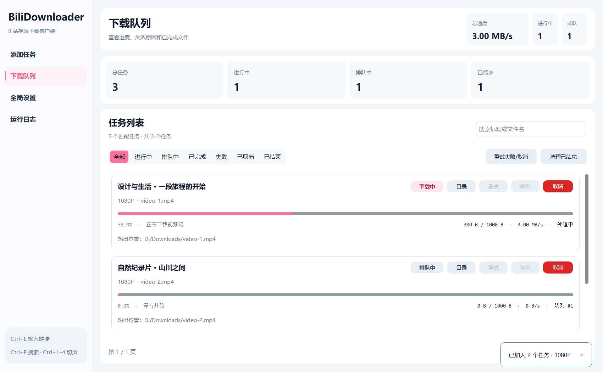

# BiliDownloader

[](https://github.com/Aemeath233/BiliDownloader/actions/workflows/ci.yml)
[](LICENSE)

> [!WARNING]
> **⚠️ 使用声明：本项目仅供学习与技术交流**
>
> 请勿用于商业运营、收费下载服务或其他牟利用途。请仅下载和保存你有权使用的内容，未经权利人许可，请勿转载、售卖或传播所下载的视频。
>
> 请尊重创作者权益，遵守 B 站的平台规则和适用法律法规。项目源码的公开不代表对任何视频内容的授权。
>
> 本声明为使用倡议；源码授权仍以 [MIT 许可证](LICENSE) 为准，不构成对该许可证新增的非商业限制。

面向 Windows 的 B 站视频下载客户端。支持分享链接、BV / ep / ss 编号、分集与画质选择、下载队列、扫码登录和全局限速。

**普通用户下载 [Release 便携版](https://github.com/Aemeath233/BiliDownloader/releases/latest)，开发者按下面的源码教程运行。源码仓库不携带 Python 环境或 FFmpeg。**

## 功能

- 支持 `bilibili.com` 视频 / 番剧链接和 `b23.tv` 短链，也可粘贴分享文本或直接输入编号。
- 分集分页、全选、反选、画质记忆、文件名预览与命名模板。
- 画质选项按当前账号实际获取的媒体流筛选，并显示最高可下载画质与受限档位；取流不符时停止，避免自动降档误导用户。
- 视频、音频分开下载，使用 FFmpeg 直接封装；失败后可重试，支持备用媒体地址。
- 队列状态筛选、标题 / 文件名搜索、并发限制、全局限速、目录打开和历史记录。
- 扫码登录，Windows 当前用户 DPAPI 保护账号文件；Cookie 不发送给媒体 CDN。
- 先显示窗口、后台准备服务、其他页面按需创建；平滑进度、页面过渡与操作提示。
- 浅色 / 深色 / 跟随系统主题；界面动画可在设置里关闭。



图片为演示数据，不代表实际下载速度或账号记录。

## 便携版：不需要运行环境

1. 打开 [GitHub Releases](https://github.com/Aemeath233/BiliDownloader/releases/latest)。
2. 下载 `BiliDownloader-Portable.exe`，Windows 10/11 **64 位**电脑直接双击。
3. 粘贴链接，必要时扫码登录，选择分集与画质后加入队列。

单文件已包含 Python、程序依赖和 FFmpeg。只发送这个 exe 即可，不需要另带 `_internal` 文件夹。程序访问 B 站时需要网络；接收方自行登录。

启动时会自动释放依赖到临时目录，正常退出时清理，所以启动比文件夹版稍慢。Release 提供 SHA256 校验文件和第三方组件信息。

## 源码运行

推荐 Python 3.11；回归检查覆盖 Python 3.11 和 3.12。源码用户需要自行安装 FFmpeg，并将其 `bin` 目录加入 PATH。

### 1. 安装 FFmpeg 并配置 PATH

从 [FFmpeg 官方下载入口](https://ffmpeg.org/download.html) 选择 Windows 构建，例如 [BtbN 的 Windows 64 位包](https://github.com/BtbN/FFmpeg-Builds/releases)。

1. 解压至固定位置，例如 `C:\Tools\ffmpeg`，确认 `C:\Tools\ffmpeg\bin\ffmpeg.exe` 存在。
2. Windows 搜索“编辑账户的环境变量”，打开用户变量中的 `Path`，点击“编辑 → 新建”。
3. 添加 **包含 ffmpeg.exe 的目录**，例如 `C:\Tools\ffmpeg\bin`，保存。
4. 重新打开 PowerShell 或终端，然后验证：

```powershell
where.exe ffmpeg
ffmpeg -version
```

程序默认只检查 PATH 中的绝对目录，不扫描磁盘，也不自动下载 FFmpeg。还可以在“全局设置”中直接选择 `ffmpeg.exe` 的完整路径。共享构建需要保留其 DLL；不能只把共享构建中的 ffmpeg.exe 拿出来。

### 2. 克隆、创建环境、安装依赖

```powershell
git clone https://github.com/Aemeath233/BiliDownloader.git
cd BiliDownloader
py -3.11 -m venv .venv
.\.venv\Scripts\python.exe -m pip install -r requirements.txt
.\.venv\Scripts\python.exe main.py
```

不需要激活环境，也不需要为源码运行安装 PyInstaller。安装了 uv 的开发者也可以使用：

```powershell
uv run --no-project --python 3.11 --with-requirements requirements.txt python main.py
```

### 3. 基本使用与快捷键

先确认保存目录和 FFmpeg 状态，再粘贴链接或编号。默认保存到工作目录的 `video`；如果目录无法创建，会回退到用户的 `Downloads/BiliDownloader`。

| 快捷键 | 操作 |
| --- | --- |
| `Ctrl+L` | 打开添加任务页并聚焦链接输入 |
| `Ctrl+Enter` | 在链接输入框中解析 |
| `Ctrl+F` | 搜索下载队列；日志页中聚焦日志筛选 |
| `Ctrl+1` 至 `Ctrl+4` | 切换添加任务、队列、设置、日志 |

取消、重试与清理记录在后台执行，清理任务记录不会删除已经保存的视频。关闭窗口时，如果还有任务，会询问停止退出、最小化继续或取消关闭。

## 数据与隐私

配置、账号、任务与日志位于 `%APPDATA%\BiliDownloader`：

```text
config.json   全局设置，不保存 SESSDATA
auth.json     Windows 当前用户保护的登录信息
tasks.json    任务记录，不保存 SESSDATA
logs/         运行日志，常见账号令牌会被隐藏
```

账号文件不随 exe 分发，也不能当作跨电脑迁移登录的方式。手工修改 SESSDATA 会替换当前账号；清空后会删除保存的登录信息。默认使用扫码登录更方便。

所有请求使用 HTTPS，保留证书校验；同时加载系统信任证书与 certifi。视频链接的域名与短链跳转受到限制，账号 Cookie 只用于 B 站域名。

## 常见问题

**提示无法加载 `_internal/python311.dll`？**

你拿到的是文件夹版，只复制了其中的 exe。普通用户请从 Release 下载带 `Portable` 的单文件，文件夹版则需要整个目录一起移动。

**源码版找不到 FFmpeg？**

运行 `where.exe ffmpeg`。PATH 中应加入 `bin` 目录，修改环境变量后需要重新打开终端 / 程序，也可以在设置中选择完整 exe 路径。

**证书校验失败？**

检查系统时间与受信任证书。如果使用代理或抓包软件，确认它的证书安装正确。程序不会通过关闭证书校验来解决问题；自定义证书可通过 `SSL_CERT_FILE` / `SSL_CERT_DIR` 指定。

**看不到 4K / 高帧率画质、只能预览或被请求限制？**

账号、会员、版权与平台接口决定可用内容。下拉框仅列出当前分集实际可获取的档位，即使原视频提供 4K，当前账号可能最高只能获取 1080P。更换账号后会重新读取；若下载时平台返回不同档位，任务会停止并提示重新选择，不会自动降档。批量分集会逐集校验。412 / 429 会触发退避，建议稍后重试。当前不支持 DRM、自动拼接多段 MP4和断点续传，重试从头下载。

## 开发与构建

依赖按用途分开：`requirements.txt` 用于运行，`requirements-build.txt` 用于打包，`requirements-dev.txt` 用于开发检查。构建资源和发布程序不会进入 Git。

```powershell
.\.venv\Scripts\python.exe -m pip install -r requirements-dev.txt
.\.venv\Scripts\python.exe -m ruff check bili_client scripts tests main.py
.\.venv\Scripts\python.exe -m ruff format --check bili_client scripts tests main.py
.\.venv\Scripts\python.exe -m unittest discover -s tests -v
```

- [构建、便携验证与发布](docs/BUILDING.md)
- [源码架构与线程模型](docs/ARCHITECTURE.md)
- [代码、安全、性能与交互审查](docs/REVIEW.md)
- [第三方组件说明](THIRD_PARTY_NOTICES.md)

## 许可证

项目源码采用 [MIT](LICENSE)。便携版中的 FFmpeg 及其他第三方组件保留其上游许可证，详见 [第三方说明](THIRD_PARTY_NOTICES.md) 和 Release 附件。
