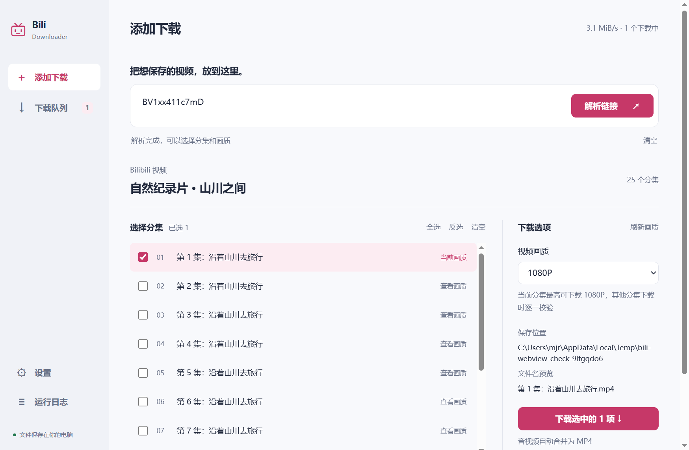

# 内嵌桌面界面迁移

## 当前交付：安装版

后续按实际体积与启动表现调整：默认交付改为 `dist/installer/BiliDownloader-Setup.exe`，约 20.6 MiB，安装后程序文件约 50.7 MiB。安装时展开依赖一次，随后直接启动；复用系统 WebView2，缺少时由安装向导提示并联网补齐，不携带固定版浏览器运行时。FFmpeg 改为约 2.2 MiB 的专用静态构建，保留下载器所需的无损合并能力。

下文四种便携构建和启动数据记录的是迁移初版，不再作为默认推荐。当前安装版的安装、升级、卸载及启动验证见 `INSTALLER-2026-10-30.md`。

## 实现范围

默认入口已从 CustomTkinter 改为 pywebview + WebView2。Python 下载服务保持原有实现，前端为本地 HTML/CSS/JavaScript，通过显式命令桥接，不需要 HTTP 服务、浏览器标签页、Node.js 或 CDN。旧 Tk 源码和回归用例保留，但发行包排除 Tk、Qt 和 CEF。

迁移覆盖：链接/分享文本解析、分集分页及跨页选择、实际可下载画质与刷新、画质记忆、文件名预览、重复任务确认、批量入队、队列状态/搜索/分页、跨页批量操作、失败重试/重选画质、目录定位/打开视频、扫码与手工凭证、登录检查/退出、全部配置项、日志、快捷键、单实例激活和关闭下载确认。

布局保留 B 站关联色，使用收敛后的莓粉主操作色 `#c63868`，浅色正文 `#20283b`，背景 `#f8f9fc`，辅助文字 `#687187`，边线 `#e2e5ed`。采用本机 Segoe UI Variable Text / Microsoft YaHei UI，无在线字体。链接输入是初始主操作，解析后缩小输入区，分集与下载选项并列；设置中的命名、FFmpeg 和手工凭证折叠展示。列表使用轻分隔而非逐项嵌套卡片。

切页使用已有页面和 180ms transform/opacity 过渡；队列按 ID 保留 DOM 节点，单页最多 30 行，分集单页最多 12 行。系统减少动态效果偏好和应用动画开关均生效。隐藏窗口降低轮询频率。

## 本地边界

- 状态快照不包含 SESSDATA、Cookie 或 refresh_token；原有 DPAPI 存储继续使用。
- 所有媒体标题、文件路径和错误作为纯文本写入 DOM。文档禁止外部资源/网络连接，窗口阻止离开本地内存页面。
- 文件操作按已知任务 ID 查找，不接受任意命令或可执行路径；打开文件限已完成的 MP4。
- 画质缓存按账号版本隔离，过期解析/画质结果不覆盖当前选择；取消扫码或关闭程序后到达的登录结果不再保存。
- 设置、账号和历史仍使用 `%APPDATA%/BiliDownloader`；本次测试均使用隔离数据，不读取真实账号和下载记录。

## 发行方式

| 构建 | 路径 | 使用条件 |
| --- | --- | --- |
| 标准单文件 | `dist/portable/BiliDownloader-Portable.exe` | 系统已具备 WebView2，约 104 MiB |
| 标准文件夹 ZIP | `dist/portable/BiliDownloader-Folder-Portable.zip` | 完整解压、保留 `_internal`，系统已具备 WebView2 |
| 完整单文件 | `dist/self-contained/BiliDownloader-Portable.exe` | 自带固定版 WebView2，约 401 MiB，免安装 |
| 完整文件夹 ZIP | `dist/self-contained/BiliDownloader-Folder-Portable.zip` | 自带运行时，解压后双击；常用时更适合，启动无需每次解包 |

完整包内的 Fixed Version Runtime 来自微软官方下载页，版本与来源记录在 `vendor/webview2/bili-runtime-source.json`。准备脚本验证微软签名并记录 CAB SHA256。固定版运行时不会自动更新，后续发行应定期更新。没有自动安装、管理员权限请求或用户启动时下载组件的步骤。

## 验证与限制

最终结果：138 项 unittest 全部通过；Ruff、Python 格式及 Prettier 检查通过；标准/完整两种运行时方案的单文件与文件夹包四项隔离验证全部通过。完整包实际使用了包内浏览器运行时，FFmpeg 合并和正常退出清理通过。

本机单次测量（不作为其他设备的启动承诺）：标准单文件约 2.51 秒就绪、标准文件夹约 1.05 秒；完整单文件约 5.65 秒、完整文件夹约 1.61 秒。文件夹 EXE 自身约 6.6 MiB，依赖保存在 `_internal`，不能用 EXE 自身体积代表完整包大小。

Python 回归覆盖原下载核心及新通信桥；新增用例验证敏感字段隔离、日志分批、命名与保存目录、重复确认、参数边界、账号缓存隔离、扫码取消/退出竞争、设置验证及资源打包定位。实际 WebView2 流程使用确定性演示服务，检查 25 集批量入队、分页选择、搜索、队列 DOM 保留、主题/动画设置、日志、快捷键、清空输入和原生关闭确认。

`scripts/verify_webview.py --screenshots --native-close-check` 导出真实渲染截图；`--compact` 检查 760×560 的最小窗口。已对解析页、队列和深色设置页进行图片检查，并修正解析后下载按钮被过大的输入区挤到下方的问题。

打包验证使用仅含 EXE 的临时目录、隔离 APPDATA、受限 PATH，检查 JavaScript/Python 就绪握手、运行依赖、FFmpeg 真实合并和退出清理。完整包还检查浏览器子进程实际来自包内 WebView2，避免误把系统运行时可用当成完整包成功。

未执行真实账号扫码、会员/付费内容下载或无运行时干净虚拟机测试。不能从确定性界面检查推断真实网络下的下载速度，也不能承诺所有设备的帧率。预览中的内容为演示数据。

